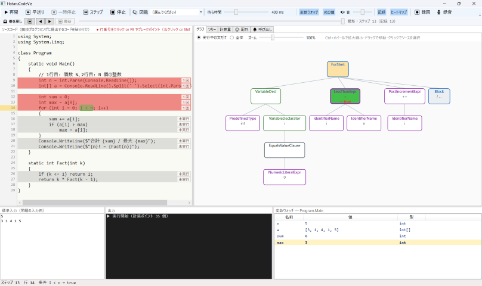

# HotaruCodeViz — C# のコードの動きを光らせて見せるビジュアライザー

C# のコードを Roslyn で構文解析して構文木を表示し、**コードを実行しながら、今実行しているノードを光らせる** WPF アプリです。
変数の値や式の値もその場で表示されるので、競技プログラミングに提出するコードの動きを1歩ずつ確かめられます。



## 必要なもの

- Windows
- .NET 10 SDK
- （なくてもよい）ffmpeg — 録画を MP4 にするときと、録音に使います。`HotaruCodeViz\tools\ffmpeg.exe` に置くか、PATH を通してください。git には入れていません

## 起動

```powershell
cd HotaruCodeViz
dotnet run
```

## 使い方

1. 左上の「ソースコード」にコードを貼り付けます（クラス＋`Main` 形式でも、トップレベルステートメントでも OK）。
2. 左下の「標準入力」に入力例を貼り付けます。`Console.ReadLine()` はここから読みます。
3. **▶ 実行** で自動再生、**⏭ ステップ** で1歩ずつ進めます。

| 操作 | 説明 |
|---|---|
| ▶ 実行 / ▶ 再開 | 「待ち時間」ごとに1歩ずつ自動で進む。止まっているときに押すと再開する |
| ⏩ 早送り | 画面を更新せず全速で実行し、**ブレークポイントで止まる**（ブレークポイントがなければ最後まで走る） |
| ⏸ 一時停止 | 自動再生や早送りを止める |
| ⏭ ステップ | 1歩だけ進む（止まっている状態から押すと、一時停止の状態で実行を始める） |
| ⏹ 停止 | 実行を打ち切る |
| 待ち時間 | 1歩ごとの待ち時間（0〜1500ms）。実行中でも変更できる。30ms 未満では画面の更新を 1 秒に 30 回までに間引く |
| 変数ウォッチ / 式の値 | 機能のオン・オフ（次の実行から反映） |
| 行番号の欄をクリック / F9 | その行にブレークポイント（赤い点）を付け外しする。実行中でも変更できる |
| ヒートマップ | 行ごとの実行回数を色と数で表示する（灰色の「未実行」は一度も通らなかった行） |

### アルゴリズム図鑑（📚 図鑑 と 🎨 配列タブ）

**🎨 配列タブ**では、変数ウォッチにある配列・List・文字列を絵で表示します。

| 変数 | 絵 |
|---|---|
| 数の1次元（`int[]`、`List<long>` など） | 棒グラフ。`i`, `j`, `lo`, `hi`, `mid`, `left`, `right`, `○○Index` などの添字っぽい変数の位置に ▲ |
| `bool[]`、`char[]`、文字列 | マス目の列（入りきらなければ折り返す）。`true` は緑 |
| 2次元（`int[,]`、`int[][]`、`List<List<int>>`） | マス目。数は小さいほど白く大きいほど青く、`[i,j]` `[y,x]` `[r,c]` などの組のマスを枠で囲む |
| `string[]`（迷路の入力など） | 文字のマス目。`#` は黒、`S` は緑、`G` は赤 |

- 値が変わったところはオレンジで光ります。濃いのが最新の変化で、薄いのはその1つ前の変化です（交換した2つが両方見えます）。しばらく変化がないと消えます。
- `int.MaxValue` や `1e9` など、INF によく使う値は「∞」と表示します。
- 1次元は 300 個まで、2次元は 40×40 まで表示します。数が2個以下の1次元配列（入力を読むための `int[] nm` など）は表示しません。
- 「変数ウォッチ」がオンのときだけ使えます。早送りや、待ち時間が短くて間引いたステップでは絵を作らないので、巻き戻しで見られるのは、画面に出したステップの絵だけです。

**📚 図鑑**（ツールバー）からは、次のサンプルを読み込めます。コードと入力、見やすい待ち時間が入って、配列タブ（再帰のサンプルは 🌳 呼び出しタブ）に切り替わります。

| 分類 | サンプル |
|---|---|
| ソート | バブルソート、選択ソート、挿入ソート、クイックソート、マージソート |
| 探索 | 二分探索 |
| 数学 | エラトステネスの篩、累積和 |
| DP | ナップサック問題、最長共通部分列（LCS） |
| グラフ | 迷路の幅優先探索（BFS）— 準備の部分は、置いてあるブレークポイントまで ⏩ 早送りで飛ばせます |
| 再帰 | フィボナッチ（素朴な再帰）、フィボナッチ（メモ化再帰）— 2つの木を比べると、メモ化で呼び出しがどれだけ減るかが見えます |

### 再帰の見える化（🌳 呼び出しタブ と 呼び出し履歴）

**🌳 呼び出しタブ**には、メソッドの呼び出しを木で描きます。上が呼んだ側、下が呼ばれた側で、実行に合わせて伸びていきます。

| 見た目 | 意味 |
|---|---|
| 濃い黄色の箱（太い枠） | 今実行中の呼び出し |
| 薄い黄色の箱と線 | そこまでの道筋（今まさに積み重なっている呼び出し） |
| `Fib(4)` の下の `→ 3` | 戻り値（`void` なら ✓、まだ戻っていなければ「実行中…」） |
| 赤い箱「💥 例外」 | 例外で抜けた呼び出し |
| 紫の `×N` | 同じメソッドを同じ引数で呼んだのが N 回目（メモ化していない再帰で増える） |

- **変数ウォッチの上**に、呼び出し履歴（`📞 Main › Fib(6) › Fib(4) › Fib(3)`）を出します。深いときは途中を「…N段…」にまとめます。
- **巻き戻し**にも対応しています。過去のステップに戻ると、木もその時点の形に戻ります。
- 一時停止中か実行が終わったあとに**箱をクリック**すると、その呼び出しの最初のステップへ巻き戻します。**右クリック**のメニューでは「戻る直前のステップへ」も選べます（戻り値を返すところや、例外で抜けるところを見られます）。巻き戻しの記録（直近 10 万ステップ）から外れた呼び出しには戻れません。
- 呼び出しが 300 回を超えると、上のほうの段と今いる道筋だけを描きます（兄弟が多いところは「… 他 N 回」、描いていない子は「+N」）。記録するのは 10 万回まで（それより多い分は数だけ）。
- 「変数ウォッチ」がオンのときだけ記録します。対象は、ふつうのメソッド・コンストラクタ・ローカル関数です（`async` メソッド、`yield` を使うイテレーター、`ref` を返すもの、ラムダは対象外）。`out` 引数は表示しません。
- 🔊 音の「呼び出しの深さ」も、この記録があるときはそれを使います。

### メモリの見える化（🧠 メモリタブ）

**🧠 メモリタブ**では、左に**スタック**（呼び出しごとのフレームと、その中の変数）、右に**ヒープ**（オブジェクト）を描き、変数からオブジェクトへの参照を矢印で結びます。
`var b = a; b.Age = 30;` のようなコードで、「a と b は別の変数だけど、同じオブジェクトを指している」ことが見て分かります。

| 表示 | 意味 |
|---|---|
| 変数の箱の中の値 | 値型（`int`・`bool`・構造体）と文字列。文字列は本当はヒープにありますが、変更できないので値のように見せています |
| 矢印 → ヒープの箱 | 参照型（クラス・配列・List・Dictionary など）。箱の `#N` は実行中ずっと変わらないオブジェクトの番号 |
| 参照 ×N | 同じオブジェクトを N 本の矢印が指している（参照の共有） |
| オレンジ | 前のステップから変わった変数・フィールド |
| 緑の枠・`new` | 新しくできたオブジェクト |
| 🗑 の列 | どの変数からもたどれなくなったオブジェクト（GC で回収されうる）。しばらく薄く残します |

- static フィールドは、フレームとは別の欄にまとめます。
- たどるのは、配列・System のコレクション・自分で書いた型のフィールドだけです（`StringBuilder` などは中身を値として見せます）。オブジェクトは 40 個、要素・フィールドは 16 個、フレームは 10 段（いちばん外側と内側の 9 段）まで描きます。
- 「変数ウォッチ」がオンのときだけ使えます。配列タブと同じく、早送りや間引いたステップでは記録しないので、巻き戻しで見られるのは画面に出したステップだけです。
- フレームの変数は、そのフレームで最後に記録した値です（ウォッチに出る変数だけが載ります）。

### 制御フローグラフ（🔀 制御フロータブ）

**🔀 制御フロータブ**には、メソッドごとの制御フローグラフ（CFG）を描きます。構文木（グラフ・ツリー）が「コードの形」なのに対して、こちらは「実行がどう流れるか」です。
Roslyn の `ControlFlowGraph` から作るので、`for` の `i++` や `foreach` の「次の要素があるか」のような、コードには書いていない流れも見えます。

| 表示 | 意味 |
|---|---|
| 箱（B0, B1 …） | 基本ブロック。途中で分かれも合流もしない、ひと続きの処理 |
| ◆ | ブロックの最後の分岐（`if (…)`・`while (…)`・`case 1 ?`・`return …` など） |
| true / false の矢印 | 条件で分かれる先。左側を回る矢印はループで戻る辺 |
| 黄色の箱 | 今実行中のブロック |
| 青い箱・矢印、×N | 通ったブロックと辺、通った回数（太いほど多く通った） |
| オレンジの矢印 | 今のブロックへ来た道筋 |
| 灰色の点線の箱 | どこからも来られないブロック（到達できないコード） |
| catch / finally の印 | そのブロックが catch・finally の中にある（`foreach` や `using` が作る後片付けは「foreach の後片付け」など） |

- 実行しなくても、コードを書けばグラフだけは描きます（回数は実行してから）。
- 「実行中のメソッドを追う」がオンなら、今実行しているメソッド（ローカル関数・`{ }` の本体のラムダも 1 つずつ）のグラフに切り替わります。上の欄で、見たいメソッドを選ぶこともできます。
- 箱をクリックすると、そのブロックのソースを選びます（実行していないとき）。
- 回数はヒートマップと同じく、早送り中も含めた最新までの合計です。巻き戻しでは、今のブロックだけがその時点の位置に戻ります。
- 計装ポイントは文と条件にしかないので、そのあいだのブロック（`for` の `i++` など）は前後の位置から道筋を補っています。`x > 0 ? a : b` の `a` と `b` のように、どちらを通ったか見分けられないところは数えません（間違った道を光らせないように）。

### 巻き戻し（タイムトラベル）

実行中の全ステップ（どこを実行したか・式の値・変数の値）を、**直近 10 万ステップ**まで記録しています（ツールバーの「記録」でオン・オフ）。
**一時停止中**か**実行が終わったあと**なら、ツールバーの下の「🕰 巻き戻し」バーで過去のステップを見られます。

| 操作 | 説明 |
|---|---|
| スライダー | 好きなステップへ移動 |
| ⏮ / ⏭ 最新 | 記録の最初 / 最新のステップへ |
| ◀（F7） | 1歩戻る |
| ▶（F8） | 1歩進む。最新にいて一時停止中なら、実際に1歩実行する |
| 変数ウォッチの行をダブルクリック（右クリック → メニューでも可） | その変数が**最後に変わったところ**へ戻る。続けて使うと、さらに1つ前の変化へ |

過去のステップでは、ソース・グラフ・ツリーのハイライト、式の値、変数ウォッチが、その時点の状態で表示されます（変数ウォッチの黄色は、同じ関数の1つ前の文からの変化です）。
「変な値になったのはどこからか」を、実行が終わってから探せます。

- 見られるのは記録した値だけで、プログラムの状態そのものを戻すわけではありません。続きは最新の位置からしか実行できません。
- 記録しているあいだは、早送りが遅くなります（自分の環境では 400 万ステップで 0.1 秒 → 1.0 秒）。とにかく速く走らせたいときは「記録」を外してください。
- ヒートマップは、巻き戻し中も最新の回数のままです。
- 「最後に変わったところ」は、文の前に記録した値を比べて探します。ローカル変数・引数は同じ呼び出しの中だけを見るので、再帰の別の呼び出しの同じ名前の変数とは混ざりません（呼び出しの木が記録できているとき）。`for (…; …; i++)` のループ変数は、更新部分の直後の条件判定へ移動します。フィールドは、どの関数で変えたかまでは正確に分からないので、値が変わる直前に実行された文へ移動します。

### 音で聴く実行（🔊 音）

ツールバーの「🔊 音」をオンにすると、1歩ごとに音が鳴ります（隣のスライダーで音量を変えられます）。

| 何で決まるか | 音 |
|---|---|
| 行番号 | 音の高さ。ペンタトニック音階（ド レ ミ ソ ラ）に当てるので、どう並んでも濁らない。ループは同じ行を繰り返すので、同じフレーズの繰り返し（リズム）になる |
| 呼び出しの深さ | 深くなるほど音程が上がる。再帰は「上がって、下りてくる」フレーズになる |
| ふつうの文 | ポロンと鳴る三角波 |
| ループの入口 | 低いベース音 |
| `return` | 長めに響くベル |
| 条件が true / false | true は高く明るい音、false は低く「ぽん」と下がる音 |
| 式（「式の値」がオンのとき） | 小さく短い音 |

- 音の長さは「待ち時間」に合わせて変わります。待ち時間 200〜500ms くらいがいちばん聴きやすいです。
- 早送り中は鳴りません。巻き戻しで1歩ずつ動かすと、そのステップの音が鳴ります。
- 呼び出しの深さはスタックの段数で測ります。そのため LINQ やラムダの中も1段深く数えられます。

### 録画と録音（⏺ 録画 / 🎙 録音）

ブログや解説に使えるよう、実行の様子を保存できます。保存先は `ビデオ\HotaruCodeViz` で、保存が終わるとエクスプローラーで開きます。

| ボタン | 保存されるもの |
|---|---|
| ⏺ 録画 | ウィンドウ全体を 1 秒あたり 10 コマで録って **GIF** にします。ffmpeg があれば **MP4** も作ります。🔊 音がオンなら、音も入れます（**WAV** も残ります） |
| 🎙 録音 | 鳴っている音だけを **WAV** に保存します（🔊 音がオフなら自動でオンにします） |

- もう一度押すと止まります。録画は 3 分までです。
- 画面は 0.6 倍に縮めて録ります。GIF は 252 色の固定パレットで、前のコマから変わった部分だけを書くので小さくなります（15 秒で 2MB くらい）。
- **ffmpeg が見つからないときは、録音は使えません。** 録画も GIF だけ（音なし）になります。
- MP4 の映像は、ffmpeg に入っている H.264 エンコーダ（libx264 → libopenh264 → Windows の Media Foundation の順に探す）で作ります。

### 計算量を調べる（ヒートマップと「計算量」タブ）

- **ヒートマップ**：実行すると、各行の右端に実行回数が出て、回数が多い行ほど赤くなります（色は対数で決めます）。どの行が重いかが一目で分かります。一度も実行されなかった行は灰色になるので、テストで通っていない場所も分かります。
- **計算量タブ**：N の値（例: `10, 100, 1000, 10000`）と入力のテンプレートを決めて **📏 まとめて測定** を押します。N ごとに入力を作って全速で実行し、次のものを出します。
  - N ごとのステップ数（文と条件の実行回数）の表と、両対数のグラフ
  - 増え方の推定（例: `N^1.98 → O(N²) っぽい`）
  - `N = 100,000` などの大きな N で何ステップになるかの予想
  - ヒートマップには、最後の N の実行回数が出ます

入力テンプレートの書き方（`N` のところには `N*2` や `N/2` のような式も書けます）：

| 書き方 | 意味 |
|---|---|
| `{N}` | N の値 |
| `{nums N 1 100}` | 1〜100 の乱数を N 個（空白区切り） |
| `{seq N}` | `1 2 3 … N` |
| `{rows N 3 1 9}` | 1〜9 の乱数 3 個の行を N 行 |
| `{chars N .#}` | `.` と `#` からなるランダムな N 文字 |
| `{grid N N .#}` | `.` と `#` からなる N 行 N 列のマス目 |

例：競技プログラミングでよくある「1行目に N、2行目に N 個の整数」なら `{N}` と `{nums N 1 100}` の2行です（最初からこれが入っています）。乱数の種は固定なので、何度測っても同じ入力になります。1 回の実行が 3 億ステップを超えたら、そこで測定を打ち切ります。

### 大きな入力を試すとき（ブレークポイント＋早送り）

競技プログラミングの本番サイズの入力でも、気になるところだけゆっくり見られます。

1. 気になる行の行番号をクリックして、ブレークポイントを付けます。
2. **⏩ 早送り** を押すと、その行まで全速で進んで止まります。止まったところで変数や式の値を確認できます。
3. そこから **⏭ ステップ** で1歩ずつ進めるか、**⏩ 早送り** で次のブレークポイントまで進めます。

### 条件付きブレークポイント

「`i == 500` のときだけ止まる」のように、条件が true のときだけ止まるブレークポイントです。

- 行番号を**右クリック**（またはその行で **Shift+F9**）すると、条件を入力するダイアログが出ます。条件付きのブレークポイントは「?」入りの印になります。
- 条件には、**その場所で使える変数やメソッド**がそのまま使えます（例 `i == 500`、`sum > 100 && a[i] % 2 == 0`、`IsPrime(i)`）。条件の中で呼んだメソッドは、ステップに数えません。
- `for (...; i < n; ...)` の行に付けると、ループの条件を調べるたびに（毎周）判定します。
- 空にして OK を押すと条件だけ外れます。左クリックでブレークポイントごと外れます。

うまくいかないときは、出力欄に理由が出ます。

| こんなとき | どうなるか |
|---|---|
| コンパイルできない条件（存在しない変数、bool でない式など） | 実行は止めずに「行 N の条件は使えません」と出して、その行では止まりません |
| foreach の行に、ループ変数を使う条件を付けた | 変数はループの中でしか使えないので、ループの中の行に付けてください |
| struct のメソッドの中で、フィールドを使う条件 | 条件はラムダとしてコンパイルするので使えません。ローカル変数か引数を使ってください |
| 条件の実行中に例外が出た（配列の範囲外など） | false とみなして続けます（知らせるのは1回だけ） |

条件はコードと一緒にコンパイルするので、実行中に付けたり変えたりした条件は**次の実行から**有効になります。それまでの間、印は白抜きになり、その行では止まりません。

### 画面

- **ソースコード**：実行中の箇所に色が付きます。
- **グラフ** タブ：構文木を図で表示します。各ノードの下に評価された値（`→ 7` など）が出ます。
  - 「実行中の文だけ」：今の文の部分木だけを大きく表示します。中にある別の文は畳んで1つの箱にします。
  - 「全体」：プログラム全体の構文木を表示します。
  - Ctrl＋ホイールで拡大縮小、ドラッグで移動、ノードをクリックするとソースの該当箇所に色が付きます。
- **ツリー** タブ：トークンまで含めた構文木をツリー表示します。クリックするとソースの該当箇所に色が付きます。逆に、ソースのカーソル位置に対応するノードも選択されます。
- **出力**：`Console.Write` / `WriteLine` の出力です。
- **変数ウォッチ**：今いるメソッドのローカル変数・引数・フィールドの値です。前回から変わったものは黄色の太字になります。

### 色の意味

| 色 | 意味 |
|---|---|
| 赤い点（行番号の欄） | ブレークポイント |
| 黄色の帯（行番号の欄） | 今実行している行 |
| オレンジ | 今から実行するステートメント |
| 紫 | 評価された式（値も表示） |
| 緑 / 赤 | `if` / `while` / `for` / `do` の条件が true / false |
| 薄いオレンジ | 少し前に実行したノード（だんだん薄くなる） |

## 仕組み

```
ソース ─ 構文解析 ─▶ SyntaxTree ─▶ グラフ・ツリーに表示
                        │
            Instrumenter（CSharpSyntaxRewriter）で通知コードを差し込む
              ・各ステートメントの前に  Tracer.Hit(id, new object[] { 変数... })
              ・条件式を                Tracer.Cond(id, 条件)
              ・式を                    Tracer.Expr(id, 式)
              ・メソッドの本体を        Tracer.Enter … try { } finally { Tracer.Exit } で包む
                        │
            CSharpCompilation でメモリ上にコンパイル
                        │
            別スレッドで実行 ── Tracer が UI に通知して待つ ──▶ id に対応するノードを光らせる
```

- 差し込む ID と **元の構文木のノード** の対応を記録しておくので、実行時の通知を表示中のノードにそのまま対応付けられます。
- **変数ウォッチ**：`SemanticModel` の `LookupSymbols`（スコープ内の変数）と `AnalyzeDataFlow(...).DefinitelyAssignedOnEntry`（確実に値が入っている変数）を使って、その時点で読める変数だけを渡します。
- **式の値**：包んでも意味が変わらない式だけを `Tracer.Expr` で包みます。代入の左辺、定数、ラムダ、`null` などの target-typed な式、値型のレシーバー、パターン変数を含む式などは包みません。
- **安全装置**：それでも計装後のコードがコンパイルできなかったときは、エラーの位置から原因の `Tracer.Expr` / `Tracer.Hit` を特定して外し、コンパイルし直します。外したときは出力欄に `ℹ` で知らせます。
- 値は通知した時点で文字列にします。あとから配列が書き換わっても、表示はその時点の値のままです。
- **早送りと間引き**：`Tracer` は1歩ごとに「UI に知らせるかどうか」を決めます。早送り中や間引き中は、知らせずにステップを数えるだけで先に進みます。値の文字列化もしません。ブレークポイントは、ステートメントと条件式の計装ポイント ID ごとの true/false の配列にして渡すので、判定は配列を1回引くだけです。
- **条件付きブレークポイント**：条件のある行では、計装で `Tracer.BreakIf(id, () => (条件));` を `Tracer.Hit` の手前に、ループの条件では `Tracer.Cond(id, 条件式, () => (条件))` を差し込みます。ラムダにするので、その場所のローカル変数がそのまま使えます。条件がその場所でコンパイルできなければ（変数がスコープにないなど）、その場所の条件だけを外してコンパイルし直します。
- **呼び出しの木**：メソッドの本体を `int __call3 = Tracer.Enter(3, new object[] { 引数… }); try { … } catch (Exception) when (Tracer.Fail(__call3)) { throw; } finally { Tracer.Exit(__call3); }` に書き換え、`return x;` を `return Tracer.Return<型>(__call3, x);` にします（例外フィルターは常に false を返すので、例外は捕まえずに「例外で抜けた」ことだけ記録します）。入口と出口ではステップを数えず、そのときのステップ番号を記録するので、「ステップ t の時点の木」は *呼ばれたのが t より前・戻ったのが t より前か* で決まり、巻き戻しでもそのまま使えます。これが原因でコンパイルできないメソッドは、そのメソッドだけ木から外します。
- **巻き戻し**：`Tracer` が各ステップの `HitEvent`（ID・値・ウォッチ・通し番号）をリングバッファ（`ExecutionHistory`）に記録します。過去のステップを表示するときは、その時点で実行中だった文までさかのぼり、そこから表示したいステップまでの記録を画面に「再生」して状態を組み立てます。
- **軽量化の工夫**：一度描いたグラフは使い回します。ツリーの子ノードは開いたときに作ります。出力は 0.1 秒ごとにまとめて画面に書き出します。

## 速さの目安

自分の環境（Debug ビルド）で、`for` ループの中で `s += i` するだけのコードを測った結果です。1周は「条件・文・式2つ」の4ステップです。

| モード | 結果 |
|---|---|
| ⏩ 早送り | 100 万回ループ（400 万ステップ）が約 0.1 秒 |
| ▶ 実行・待ち時間 0（間引き） | 20 万回ループ（80 万ステップ）が約 0.1 秒 |
| ▶ 実行・待ち時間 30ms 以上 | 1歩ごとに画面を更新するので、ほぼ「待ち時間 × ステップ数」かかる |

構文解析と表示は、数百行程度までなら快適です（ツリーの子ノードは開いたときに作ります。待機中の「全体」グラフは、ノードが 1,500 個を超えると自動では描きません）。

## ファイル構成

| ファイル | 役割 |
|---|---|
| `Instrumenter.cs` | 構文木を書き換えて `Tracer` の呼び出しを差し込む。どの式を包めるか、どの変数を見せるかの判定もここ |
| `CodeRunner.cs` | コンパイル（計装と、失敗時のやり直しを含む）と、回収できる `AssemblyLoadContext` での実行 |
| `Tracer.cs` | 実行中のコードから呼ばれるフック。UI への通知、待ち時間、一時停止、ステップ実行、停止 |
| `ValueFormatter.cs` | 値の文字列化（配列・コレクション・辞書・2次元配列など） |
| `SyntaxGraph.cs` | 構文木を Canvas にグラフとして描画。共通の配色（`Palette`）もここ |
| `InputGenerator.cs` | 計算量の測定用に、テンプレートから標準入力を作る |
| `MainWindow.xaml(.cs)` | 画面と、各表示の連動 |
| `MainWindow.Complexity.cs` | ヒートマップと計算量の測定（推定・グラフ） |
| `ArraySnapshot.cs` | 配列・List・文字列の中身のコピー（`ArrayShot`）。中身が同じなら前のコピーを使い回す |
| `ArrayView.cs` | 🎨 配列タブの絵（棒グラフ・マス目の列・2次元のマス目、▲ や枠、変化の光） |
| `CallLog.cs` | 呼び出しの木の記録（`Tracer.Enter` / `Exit` で積み、ステップ番号から「その時点の木」を引く） |
| `CallTreeView.cs` | 🌳 呼び出しタブの木の描画（多いときは上の段と今いる道筋だけ） |
| `MainWindow.Calls.cs` | 呼び出しの木・呼び出し履歴の更新とスクロール |
| `MemorySnapshot.cs` | スタックのフレームから参照をたどって、ヒープのオブジェクトをコピーする（`MemoryShot`） |
| `MemoryView.cs` | 🧠 メモリタブの絵（スタック・ヒープ・参照の矢印、変化・新しいオブジェクト・🗑 の表示） |
| `FlowGraph.cs` | 制御フローグラフ（Roslyn の CFG から作る・段の決め方・計装ポイントとの対応）と、通った回数を数える `FlowTracker` |
| `FlowView.cs` | 🔀 制御フロータブの絵（ブロックの並べ方・矢印の通り道・回数） |
| `MainWindow.Flow.cs` | 制御フロータブの更新（実行前の下見、実行中のメソッドを追う、スクロール） |
| `MainWindow.Memory.cs` | メモリタブの更新（計装ポイントの情報から変数の名前・型を付ける、巻き戻し） |
| `AlgorithmSamples.cs` | 📚 図鑑のサンプル（コード・入力・説明・待ち時間） |
| `MainWindow.Samples.cs` | 図鑑の読み込み |
| `MainWindow.Conditions.cs` | 条件付きブレークポイント（条件の入力ダイアログ・行番号欄の印・使えない条件の知らせ） |
| `MainWindow.History.cs` | 巻き戻し（記録から過去のステップの画面を組み立てる） |
| `SoundEngine.cs` | 小さなシンセサイザー（NAudio で再生）と、ステップを音に変換する `SoundMapper` |
| `MainWindow.Sound.cs` | 音のオン・オフ、音量、鳴らすタイミング |
| `ScreenRecorder.cs` | 画面の録画（コマを PNG で保存 → GIF / ffmpeg で音付き MP4）と ffmpeg を探す処理 |
| `GifWriter.cs` | アニメーション GIF の小さなエンコーダ（固定パレット・差分だけ書く・LZW） |
| `MainWindow.Recording.cs` | 録画・録音のボタン |

## 制限事項

- 対応言語は C# だけです。
- `=>` で書いたメソッドやプロパティの本体は、ステートメント単位では光りません（中の式は光ります）。
- 計装しているぶん、早送りでも普通の実行よりは遅くなります（各ステップで呼び出しが1回増え、変数ウォッチ用の配列も作るため）。
- ブレークポイントは行番号で覚えています。止めたあとにコードを編集して行がずれても、ブレークポイントはその行番号に残ったままです。
- `if (x) return;` のように1行に複数の文がある行にブレークポイントを付けると、その行の文と条件それぞれで止まります。
- 変数ウォッチに出るのは、今いる呼び出しの変数だけです（呼び出し履歴は表示しません）。
- 停止は、実行中のコードの中で例外を投げて止める仕組みです。ユーザーのコードが `catch (Exception)` で全部受け止めていると、すぐには止まらないことがあります。
- マルチスレッドのコードは想定していません。
- 制御フロータブでは、`=>` で書いたメソッドの中や、`try` から `catch` / `finally` へ移る流れは数えられません（ブロックの回数だけ数えます）。「変数ウォッチ」がオフだと呼び出しの区別がつかないので、再帰では道筋の一部が数えられないことがあります。
